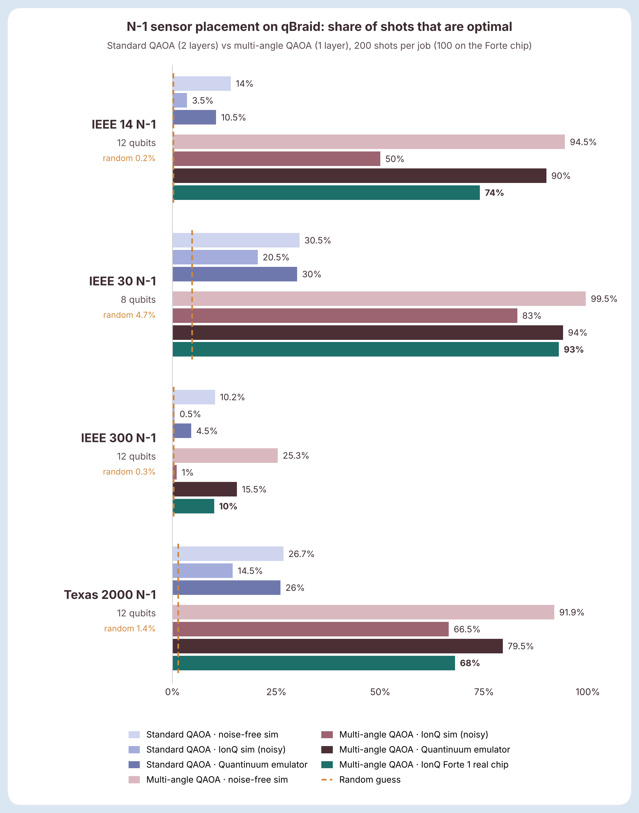

# N-1 stretch goal: reduction plus QAOA

The N-1 stretch goal for our Tennessee Quantum Hackathon solution (qBraid challenge 2, placing PMUs on TVA's grid). It builds on the main solution at the root of this repo: the same exact reduction, split into pieces and QAOA per piece, now for N-1, where every bus has to be seen twice.

This folder runs on its own: run every command below from inside `multi-angle-QAOA/`.

## The idea

A PMU at a substation sees that substation and every neighbor. The main repo places the fewest PMUs so every bus is seen once. **N-1** asks for every bus to be seen by at least two PMUs, so if any one PMU fails, the whole grid is still observable.

We keep the same pipeline and give every bus a need of 2 sightings:

1. **Exact reduction** (`reduce_need`), extended so it stays exact when a bus needs 2 sightings:
   - **Forced PMUs.** If a bus can be seen from only as many spots as it needs, all of them get a PMU.
   - **Covered for free.** If every spot that sees bus u also sees bus w, and u needs at least as much as w, then w's rule is dropped.
   - **Useless spots.** A spot that sees no bus still needing a sighting is dropped.
   - **Dominated spot**, used only when every bus the weaker spot serves needs exactly 1 more sighting. The plain version of this rule is not safe for N-1.
2. **Split** what is left into independent pieces (`split_pieces`).
3. **QAOA per piece** up to 16 qubits; bigger pieces go to ILP. Cost = sensors + P × Σ max(0, 2 − sightings) with P = 2, written exactly as Pauli-Z terms. A term on w qubits costs 2(w − 1) CX gates.
4. **Reassemble** the forced PMUs plus each piece's answer, and check it bus by bus.

We compare two circuits for step 3:

- **Standard QAOA,** 2 layers, with one shared angle pair per layer (the circuit from the main repo).
- **Multi-angle QAOA,** 1 layer, with its own angle for every cost term and every qubit. It has half the two-qubit gates and finds the optimum far more often.

## Results

### The reduction is exact on every grid

Fixed PMUs + the best answer on every piece = exact ILP on every grid (`python verify.py`).

| Grid | Plain min (seen once, reference) | N-1 min | Fixed by rules | Pieces (qubits) | N-1 ILP (ms) | Reduction (ms) |
|---|---|---|---|---|---|---|
| IEEE 14 | 4 | 9 | 2 | 12 | 4.0 | 0.2 |
| IEEE 30 | 10 | 21 | 8 | 9, 8, 3 | 12.4 | 0.7 |
| IEEE 57 | 17 | 33 | 2 | 55 | 5.7 | 0.8 |
| IEEE 118 | 32 | 68 | 22 | 84 | 8.1 | 15.0 |
| IEEE 300 | 87 | 202 | 135 | 84, 39, 12 | 7.2 | 56.1 |
| Texas 2,000-bus (ACTIVSg2000) | 512 | 1,354 | 635 | 1274, 22, 15, 12, 3, 3 | 129.2 | 3,885.6 |

Pieces up to 16 qubits go to QAOA, bigger ones to ILP. Also in `results/appendix_n1_sensors.csv`.

### N-1 on qBraid: share of shots that are the optimal placement



| N-1 piece | Method | Two-qubit gates | Noise-free | IonQ sim (Forte-1 noise) | Quantinuum H2 emulator | **IonQ Forte 1 real chip** | Random guess |
|---|---|---|---|---|---|---|---|
| IEEE 14, 12 qubits | standard, 2 layers | 168 | 14.0% | 3.5% | 10.5% | not run | 0.2% |
| | multi-angle, 1 layer | 84 | 94.5% | 50% | 90% | **74%** | |
| IEEE 30, 8 qubits | standard | 68 | 30.5% | 20.5% | 30% | not run | 4.7% |
| | multi-angle | 34 | 99.5% | 83% | 94% | **93%** | |
| IEEE 300, 12 qubits | standard | 572 | 10.2% | 0.5% | 4.5% | not run | 0.3% |
| | multi-angle | 284 | 25.3% | 1% | 15.5% | **10%** | |
| Texas 2000, 12 qubits | standard | 136 | 26.7% | 14.5% | 26% | not run | 1.4% |
| | multi-angle | 68 | 91.9% | 66.5% | 79.5% | **68%** | |

Simulator and emulator jobs used 200 shots; the Forte chip used 100. `deck_charts/n1_results_table.png` shows the same results with the sensor count each method reaches on the full grid. We also ran these circuits on Rigetti Cepheus-1 (at most 10.5% optimal; the IEEE 300 jobs failed at compile). Those numbers are in `results/stretch_qbraid_results.json` but not in the chart.

### Hardware job IDs (IonQ Forte 1 via qBraid on AWS, multi-angle QAOA)

| Circuit | Job ID | Shots |
|---|---|---|
| IEEE 14 N-1, 12 qubits | `aws:ionq:qpu:forte-1-0ad3-qjob-6af9186dc8f5265fb3f22e8d` | 100 |
| IEEE 30 N-1, 8 qubits | `aws:ionq:qpu:forte-1-0ad3-qjob-6af91b1fc8f5265fb3f2314d` | 100 |
| IEEE 300 N-1, 12 qubits | `aws:ionq:qpu:forte-1-0ad3-qjob-6af93338c8f5265fb3f244c7` | 100 |
| Texas 2000 N-1, 12 qubits | `aws:ionq:qpu:forte-1-0ad3-qjob-6af91b32c8f5265fb3f23157` | 100 |

Every simulator, emulator and Rigetti job ID is in `results/stretch_qbraid_results.json` and `results/rigetti_n1_jobs.json`.

### Bitstrings from the chip

- `results/forte_n1_counts.json`: raw counts from qBraid, bitstring → number of shots.
- `results/forte_n1_bitstrings.csv`: every bitstring the chip returned, with its count, the buses it puts PMUs on, and whether it meets the N-1 rules and is optimal.
- `results/n1_qubit_map.json`: for each piece, which bus each qubit stands for, the PMUs already fixed by the reduction, and every optimal bitstring.

Bitstrings are written qubit n−1 … qubit 0 (the rightmost character is qubit 0), as qBraid returns them. The full placement for a grid is the fixed PMUs plus the buses of the piece's bitstring plus the other pieces' answers. `python bitstrings.py` rebuilds the CSV and the map.

| N-1 piece on Forte 1 | Shots meeting the N-1 rules | Shots that are optimal |
|---|---|---|
| IEEE 14 | 79 | 74 |
| IEEE 30 | 96 | 93 |
| IEEE 300 | 37 | 10 |
| Texas 2000 | 80 | 68 |

### Raising accuracy on the hard piece

`boost.py` tries warm-start QAOA (start each qubit tilted toward the LP answer, no extra gates) and recursive QAOA combined with our reduction rules. On the IEEE 300 N-1 piece, warm start lifts the noise-free optimal share from 25% to 87%, and recursive QAOA plus reduction reaches the optimum with circuits that shrink every round (`results/boost_study.json`). These were not run on hardware.

### What to keep in mind

- Classical ILP solves every N-1 problem here exactly in 4 to 130 ms, so these results do not show a quantum speedup.
- QAOA angles were tuned classically before each job was sent, and that tuning time is not in the run-time table.
- What the results do show: the exact reduction turns a 2,000-bus N-1 problem into pieces of at most 15 qubits for the quantum side, and multi-angle QAOA solves those pieces on a real trapped-ion chip. On IEEE 14, IEEE 30 and Texas 2000, 68% to 93% of chip shots are optimal, against 0.2% to 4.7% for random guessing. The IEEE 300 piece is the hard one (284 two-qubit gates): 10% optimal on the chip, still about 37 times random guessing.
- On bigger grids the N-1 reduction leaves some pieces (55 to 1,274 qubits) that only ILP can handle today.
- The run times in `results/appendix_n1_run_times.csv` are provider-side wall times, and the Quantinuum and Forte numbers include queue waiting.

## Repo map

| Path | What it is |
|---|---|
| `stretch2.py` | Exact N-1 reduction (`reduce_need`) and exact ILP (`ilp_need`) |
| `pieces.py` | Splits a reduced problem into independent pieces |
| `stretch_quantum.py` | The N-1 pipeline per grid: reduction, split, Pauli-Z cost, standard and multi-angle QAOA, tuning, noisy check, reassembly. Writes `results/stretch_quantum.json` and `hardware/stretch/*.qasm` |
| `run_stretch_qbraid.py` | Submit and collect the N-1 circuits on qBraid, plus a local dry run with Qiskit Aer |
| `lab/` | Stand-alone qBraid Lab runner (`stretch_lab.py`), the exact circuits sent (`qasm/`) and the optimal answers used to score them (`scoring.json`) |
| `boost.py` | Warm-start QAOA and recursive QAOA with reduction on the hard pieces |
| `bitstrings.py` | Turns chip bitstrings into PMU buses (`results/forte_n1_bitstrings.csv`, `results/n1_qubit_map.json`) |
| `verify.py` | Rechecks the reduction on all grids and the scoring of the chip results |
| `hardware/stretch/` | Every compiled N-1 piece circuit (OpenQASM 2): `_L1`, `_L2` standard layers and `_maqaoa` multi-angle |
| `hardware/forte/` | Circuits sent to IonQ Forte 1 (OpenQASM 3). The IEEE 300 job ran `lab/qasm/ieee300_N-1_multi.qasm` |
| `results/` | JSON and CSV outputs, including the appendix tables and the chip bitstrings |
| `deck_charts/` | The N-1 chart, its script, and the results table |
| `pmu_lib.py`, `check.py` | Copied unchanged from the repo root so this folder runs on its own (`check.py` is the organizers' checker) |
| `data/` | IEEE test grids and the Texas 2,000-bus grid in the challenge's JSON format |

## Running it

```bash
cd multi-angle-QAOA
pip install -r requirements.txt
python verify.py                  # reduction is exact on every grid + chip scoring
python pieces.py ieee300 activsg2000   # fixed PMUs and piece sizes
python bitstrings.py              # chip bitstrings -> PMU buses
python stretch_quantum.py         # full pipeline: tunes QAOA on every piece (several minutes)
python deck_charts/make_n1_qbraid_chart.py
```

For the cloud jobs, copy `lab/` into qBraid Lab, use the qBraid-SDK kernel and run `python stretch_lab.py submit ionq` and `python stretch_lab.py submit quantinuum` (both free), then `python stretch_lab.py collect`. `submit forte-aws multi` sends the multi-angle circuits to the real Forte 1 chip, which costs about 830 qBraid credits per 100-shot job.

## Data sources

The IEEE 14, 30, 57, 118 and 300 bus test cases and the Texas A&M ACTIVSg2000 synthetic grid come from MATPOWER. See `data/README.md`.
